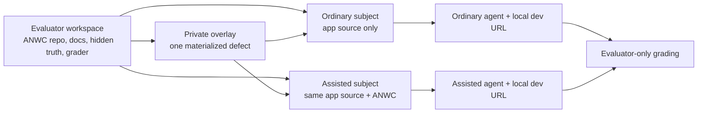

# Evaluator workspace model

An agent that can only open a URL can inspect a page, but it cannot repair the application because it has no source to edit. An agent that clones this repository can repair source, but it can also read public scenarios, expected codes, tests, planning documents, and Git history. Neither arrangement is a fair repair comparison by itself.

Use three separate areas:



## What each party may see

| Material | Evaluator | Ordinary agent | Assisted agent |
| --- | --- | --- | --- |
| App source with one materialized defect | yes | yes | yes |
| Local URL served from that source | yes | yes | yes |
| ANWC CLI/runtime | yes | no | yes |
| Public fixture lab and scenario switch | yes | no | no |
| Benchmark docs, test matrix, expected codes | yes | no | no |
| Hidden mutation, truth, grader, prior patches | yes | no | no |
| Git history and remote origin | yes | no | no |

The two subject folders must have the same application files and the same defect. The only intended difference is that the assisted folder can invoke ANWC.

## Do not give the agent an ANWC clone

The evaluator may clone or pull ANWC. The subject agent should receive a newly exported directory instead. A Git worktree is also unsuitable because its `.git` file points back to readable history.

URL-only access is valid for a **detection-only** experiment. It is not a repair experiment. For repair, the agent works inside its own subject folder, edits application files there, starts its own development server, and uses that folder's URL.

## Build a subject folder

For the current landing/dashboard corpus, use the paired preparer rather than hand-writing overlays:

```sh
npm run bench -- prepare-pair . --fixture pricing-blocked --out C:\temp\anwc-pair --source-revision SOURCE_SHA --detector-revision DETECTOR_SHA
npm run bench -- check-pair C:\temp\anwc-pair
```

Give one fresh folder to each agent: `ordinary/` to the ordinary run, or `assisted/` to the ANWC run. The neutral `TASK.md` is the agent-facing brief. The evaluator keeps `receipt.json` outside both agents’ working folders. Before an agent starts, `check-pair` confirms the two application copies and their immutable inputs still match the receipt.

After the agent returns a repair, grade the returned folder independently. The command installs from the frozen lockfile, starts its own local server, runs the evaluator-only behavior checks at every required viewport, writes a result file, and then shuts down the server.

```sh
npm run bench -- grade --receipt C:\temp\anwc-pair\receipt.json --subject C:\temp\anwc-pair\ordinary --condition ordinary --port 4301 --output C:\temp\ordinary-result.json
```

Use a distinct port for the assisted subject. A `failed` result means required behavior remains broken; `integrity-failed` means the agent altered a frozen task, tool, config, or application file outside `examples/<app>/src/`; `infrastructure-failed` preserves the server/browser error instead of being scored as a repair.

## Legacy manual subject packaging

Keep the private overlay in a directory outside the repository. It contains only replacement files that materialize one fixture. At minimum it replaces `examples/shop/src/main.tsx` so there is no query-driven public scenario switch. An ordinary overlay also replaces `examples/shop/vite.config.ts` with a normal React/Vite configuration that omits ANWC.

From the evaluator repository, create a fresh destination for each run:

```sh
npm run bench -- package-subject SOURCE_ROOT SUBJECT_A --overlay PRIVATE_OVERLAY --condition ordinary
npm run bench -- package-subject SOURCE_ROOT SUBJECT_B --overlay PRIVATE_OVERLAY --condition anwc-assisted
```

The packager removes known answer-bearing paths, strips ANWC from ordinary scripts and workspaces, applies the overlay, then rejects the destination if its inventory still leaks known material. It will not overwrite an existing destination.

The packager does not make the surrounding computer safe by itself. Use separate agent sandboxes or access controls if the agent can browse arbitrary parent folders, shared drives, browser history, or evaluator services.

## Run one fair pair

1. Create subjects A and B from the same source commit and private overlay.
2. Install dependencies and start each subject's dev server independently. Assign distinct ports, for example 4301 and 4302.
3. Confirm both pages render the same defect and viewport/state before the agents start.
4. Start fresh sessions. Give A normal tools and B the same normal tools plus ANWC. Do not reuse context, screenshots, patches, or browser state.
5. Give both the same source-editing repair prompt and the same wall-time cap. The prompt must not name the hidden defect.
6. Stop each run at completion or the cap. Save the patch and logs outside the subject folder.
7. Apply each patch to a clean evaluator copy and run independent checks. Record the result in the benchmark ledger.

Counterbalance order across pairs: run A then B for half of the fixtures and B then A for the rest. This reduces the chance that your own familiarity with a case affects one condition more than the other.

## Public fixture lab versus hidden corpus

`/lab?case=...` is intentionally easy to inspect. It is for manually learning the command and confirming the collector behaves as expected. The default pages `/`, `/catalog`, `/checkout`, and `/account` are clean routes.

The lab is not part of a scored corpus. A hidden overlay should use the same kind of defect but integrate it naturally into one page, remove the lab selector, use a neutral URL, and omit answer-bearing attributes or file names. Keep its independent grader outside the exported subject folder.
