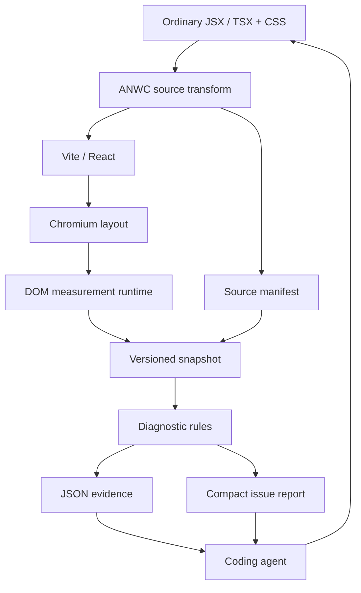

# ANWC implementation plan

Planning date: 2026-09-15, Australia/Sydney. Baseline: authenticated SSH clone succeeded; remote repository contained no commits or source. The three supplied notes are concept material, not an implementation to preserve. This document specifies work to do; see [PROGRESS](PROGRESS.md) for what has actually been done.

## 1. Product decision

Build **a React-compatible development compiler plus a rendered-page diagnostic runtime**, beginning as a Vite plugin. The long-term framework can grow around a successful inspection interface. Requiring a new router, component vocabulary, or a migration from Next.js before demonstrating value would delay the useful experiment.

The immediate user is a coding agent fixing a web UI. Its questions are concrete:

- Which button is blocked, by which element, in this viewport and state?
- Which text exceeds its available box or declared line budget?
- Which ancestor clips a target?
- Where in source does the affected rendered element originate?
- After an edit, does the finding disappear without breaking other states?

The product hypothesis is that a compact answer to these questions reduces agent work. Lower token cost, faster repair, and better accuracy are hypotheses to measure, not launch claims.

Do not promise that screenshots become unnecessary for every task. Typography quality, image content, color harmony, gradients, masks, canvas, and arbitrary compositing need other evidence. A successful MVP makes many mechanical layout checks possible without a screenshot and identifies where its evidence stops.

## 2. Correct the foundations in the sample implementation

| Sample approach | Failure | Replacement |
| --- | --- | --- |
| Add all ancestor `z-index` values | Nested stacking contexts do not compose numerically | Use browser hit testing for pointer order; defer general paint coverage |
| Treat every overlapping rectangle as an occluder | Transparent boxes and backgrounds may not cover content | Separate geometric overlap, pointer obstruction, and paint visibility |
| Sum overlapping occluder areas | Shared area can be counted repeatedly | No pixel coverage claim in v0; any later area solver must union regions |
| A line/column is the element ID | Cross-file collisions and repeated list instances | Source-site ID plus live DOM instance ID |
| Only inspect interactive elements | Misses titles, prices, labels, and container overflow | Discover text-bearing elements and relevant containers too |
| Every wrap/scroll overflow is a bug | Paragraph wrapping, carousels, and ellipsis may be intentional | Report facts separately; evaluate declared intent when available |
| `el.click()` or assigning `.value` proves usability | Bypasses real pointer delivery and framework input behavior | Use normal browser automation actions for behavioral verification |
| Observer rescans the full DOM on every mutation | Adds cost and can create a feedback loop | Snapshot on demand first; measure before adding observers |
| Hard-coded sub-millisecond/token savings | No measurements support these numbers | Capture runtime, actual usage, truncation, and failures |

CSSOM explicitly distinguishes a hit-test target from the topmost painted element. This is the reason ANWC's protocol separates those concepts. [CSSOM View, document hit-testing APIs](https://drafts.csswg.org/cssom-view/#extensions-to-the-document-interface)

## 3. Tonight's deliverable and cut line

### Required end-to-end path

1. Developer runs the ordinary React/Vite app.
2. Plugin transforms JSX/TSX host elements and records original source locations.
3. Chromium renders the page at a specified viewport.
4. CLI waits for a bounded readiness condition, invokes one runtime snapshot, and associates measurements with source records.
5. Rules produce evidence-bearing findings; serializer returns a short issue list and a full JSON artifact.
6. Agent edits application source and repeats the command on the same scenario.
7. Independent tests confirm the seeded defect is fixed and healthy behavior remains intact.

### Minimum acceptance gate

- Source metadata survives TSX, JSX, component nesting, spreads, and repeated list rendering.
- A runtime-only inspection can still discover uninstrumented DOM, with `source: null`.
- Rules cover horizontal overflow, rectangular ancestor clipping, CSS-hidden expected targets, sampled pointer obstruction, text clipping, and declared line-budget violation.
- Findings contain viewport/state, node identity, relevant measurements, method, and source when known.
- Text wrapping without a declared limit does not become an error by default.
- An offscreen item below the fold is a state observation, not automatically a defect.
- At least six supported seeded defects and six healthy controls have independent browser assertions; final target is the full matrix in [BENCHMARK](BENCHMARK.md).
- The CLI supports JSON and bounded text, closes its browser, and has deterministic exit codes.
- Ordinary production build contains neither ANWC runtime nor generated source attributes by default.
- The agent inspection path captures no screenshots; fixture authoring and independent adjudication may use them.

### Explicitly later

MCP server, WebMCP actions, WebSocket transport, live deltas, React semantic component library, JSON-LD, `llms.txt`, full CSS paint solver, Next.js adapter, browser extension, dashboard, screenshots-as-a-service, hosted accounts, publishing to npm, and a routing/SSR framework.

These remain compatible with the vision. None is needed to test tomorrow's question.

## 4. System architecture



Compiler output is not rendered geometry. Geometry is created by the actual browser after CSS, fonts, responsive rules, and application state take effect. Call the combined product ANWC; name the subcomponents precisely so users understand what the compiler contributes.

### Repository layout to create

```text
packages/
  protocol/src/          # Shared types and schema validation
  compiler/src/          # Pure JSX instrumentation transform
  vite-plugin/src/       # Vite integration, dev manifest, runtime injection
  runtime/src/           # DOM discovery, geometry, text, hit sampling
  diagnostics/src/       # Rules over normalized measurements
  cli/src/               # Browser lifecycle, capture, output
examples/
  shop/                 # Normal React app, clean default, isolated scenarios
tests/
  compiler/             # Transform semantics and source mapping
  browser/              # Real-layout edge cases and clean controls
  integration/          # CLI, build stripping, source linkage
bench/
  prompts/              # Condition-specific agent prompts
  runs/                 # Ignored raw logs; sanitized summaries can be committed
docs/
  PLAN.md PROGRESS.md TASKS.md PROTOCOL.md BENCHMARK.md DECISIONS.md
```

Keep independent evaluator answers outside the tested agent's checkout. A directory name such as `private` inside a readable repository is not isolation.

### Toolchain default

Use TypeScript, npm workspaces, Node 24 (available on this machine), Vite, React, Babel parser/traversal, a source-preserving edit library such as MagicString, and Playwright with pinned Chromium. Pin compatible dependency versions in a lockfile during T00; do not invent current package version numbers in the plan. Bun is not installed locally and is not required. Avoid a monorepo build orchestrator until normal workspace scripts are insufficient.

Use Babel to parse JSX plus TypeScript and identify insertion locations. Keep source text largely unchanged with surgical edits and a generated source map; Vite/React continue doing their ordinary transforms. Babel supports the required syntax through parser plugins. [Babel parser documentation](https://babeljs.io/docs/babel-parser)

## 5. Compiler design

### Input/output boundary

Proposed pure API:

```ts
instrument(code, { filename, root, mode })
  -> { code, map, sites, warnings } | null
```

Instrument project `.jsx` and `.tsx` files. Normalize path separators and remove query suffixes before filtering. Exclude dependencies, generated output, virtual modules, and the runtime itself. Plain `.js` containing JSX is a later opt-in; plain HTML uses runtime-only inspection initially.

Only annotate intrinsic HTML host elements in v0. Skip fragment syntax, component identifiers (`<ProductCard>`), member expressions, SVG subtrees, and script/style metadata. Elements inside a component's implementation are annotated normally. Do not inject refs, reorder hooks, wrap components, inspect event-handler source, or change React keys.

### Identity

- `siteId`: deterministic hash of normalized repository-relative file path plus opening-tag source offset and tag. Deterministic for identical source, not stable across arbitrary edits. Keep a collision check in the manifest.
- `nodeId`: assigned to the live DOM element through a WeakMap and counter scoped to the document session. Ten rendered products from one JSX site receive ten distinct node IDs.
- `data-anwc-key`: optional human semantic label, never assumed globally unique. Do not use React's private key machinery.
- Every snapshot includes its session and capture IDs. IDs from another navigation or an earlier snapshot are not durable selectors.

Generated attribute: `data-anwc-site="s_..."`. This namespace is reserved. Reject or clearly diagnose an explicit author-written collision. Append instrumentation after spreads so ordinary spread props cannot replace it. Confirm spread expressions still evaluate once. On a repeated transform, use pipeline-owned transform caching or recorded transformed content to avoid duplicate injection; do not mistake arbitrary author attributes for proof of prior instrumentation.

Manifest entries include file, tag, original line and column, and site ID. Specify one-based lines and columns in the protocol. Avoid absolute machine paths. JSX location is an anchor for repair; it is not necessarily the responsible CSS declaration. CSS source tracing can follow later.

### Vite adapter

Use a pre-transform plugin so instrumentation sees JSX, and inject a development runtime using the HTML transform hook for the Vite app. Expose a dev-only virtual manifest module, invalidated when source transforms change. Lazy route modules need their new records incorporated after navigation. Production instrumentation defaults off; a dedicated test build may opt in explicitly.

Vite documents plugin ordering and transform hooks; the exact installed version must pass the adapter smoke tests before support is claimed. [Vite plugin API](https://vite.dev/guide/api-plugin)

No HTTP diagnostic server is necessary: the CLI controls its own browser and calls the runtime in that page. This avoids confusing different tabs, viewports, sessions, or stale global server snapshots.

## 6. Browser runtime

### One read phase

Capture after the caller supplies the intended URL and state. Wait for the app's ready marker if configured, fonts with a timeout, and two frames of stable tracked geometry within a bounded window. Do not use unbounded `networkidle` as universal readiness. Include `settled: false` and reasons if the page keeps moving. This is a bounded heuristic, not proof that all asynchronous application work is finished.

Snapshot on demand. Cache computed style and box measurements for the duration of that capture. Do not write styles, scroll, focus, or click during measurement. The CLI may perform an explicitly configured scenario setup before capture and records those actions.

Collect instrumented hosts, semantic interactive elements, text-owning elements, clipping/scrolling containers, and externally encountered blockers. Assign IDs to blocker elements even when they have no compiler metadata. Deduplicate DOM instances. A budget cap yields explicit incomplete coverage metadata; it must not silently produce an all-clear.

### Coordinates and visibility facts

Use viewport-relative CSS pixels for element rectangles and hit points. Record layout viewport dimensions, scroll offset, device pixel ratio, and visual viewport scale. v0 certifies desktop/mobile browser viewports at scale 1; pinch zoom is unsupported. Record border boxes and client scrollport boxes separately. Hidden/zero-area targets must not cause divide-by-zero.

Expose independent dimensions rather than one `visible` boolean:

- Render box presence and CSS hidden reasons.
- Effective zero opacity, including an opacity-zero ancestor.
- Intersection with the viewport.
- Approximate rectangular clipping by supported ancestors.
- Pointer hit samples and blocking node IDs.
- Enabled/inert semantics.
- Paint visibility assessment, usually `unknown` in v0.

Inspect computed visibility on the target: a descendant can override an ancestor's `visibility:hidden`. Treat ancestor `display:none` and opacity-zero ancestry according to their different behavior. Disabled and inert state are separate from pointer sample results. An opacity-zero overlay can still obstruct pointer input.

### Clipping algorithm

For an untransformed HTML target, intersect its box with the viewport and each applicable rectangular ancestor clip, independently by axis. Use the ancestor client box derived from its rect, `clientLeft`, `clientTop`, `clientWidth`, and `clientHeight`, not the outer border box. Record the first and cumulative clipping contributions.

Do not blindly clip every descendant by every overflow ancestor: absolute/fixed positioning and containing-block relationships can change applicability. Limit the first implementation to verified normal-flow and explicit fixture cases; return `unknown` for unresolved containing-block cases. Nontrivial transforms, `clip-path`, masks, rounded clipping, fragmented inline boxes, and CSS overflow clip margins require capability downgrades. AABB bounds remain useful observations but do not prove the true painted region.

Scrollable clipping is initially informational. A carousel's offscreen item is normal; an expected currently visible checkout button clipped by a non-scrollable container is actionable. CSS distinguishes scrollable overflow from other overflow effects. [CSS Overflow Level 3](https://www.w3.org/TR/css-overflow-3/)

### Text measurement

Walk text nodes owned by each target, avoiding duplicate reporting by all ancestors. Read `Range.getClientRects()` for rendered text fragments, cluster fragments into approximate lines for horizontal writing, and record extents. Account for nested inline spans and repeated fragments. Compare text rectangles with supported clip bounds; also record `scrollWidth/clientWidth` and `scrollHeight/clientHeight` as overflow evidence.

Never equate `scrollHeight / lineHeight` with a reliable line count. Scroll dimensions alone cannot attribute overflow to text. Mixed fonts, bidi, vertical writing, line clamping, and decorative pseudo-elements require caveats or unsupported status. For v0, certify simple horizontal text fixtures, allow a 1 CSS px measurement tolerance, and avoid claiming glyph-perfect clipping.

`data-anwc-max-lines="1"` allows `TEXT_LINE_BUDGET_EXCEEDED`. A naturally wrapped description without this contract produces an observation only. `data-anwc-allow="text-truncation"` can acknowledge intentional ellipsis; include that acknowledged condition in JSON rather than discarding evidence.

### Pointer obstruction

For each relevant interactive target's clipped viewport rectangle, take a 5×5 grid of interior sample centers plus the exact center, deduplicating equal coordinates. At each point read browser hit testing. A hit on the target or its descendant is a delivered sample; an unrelated top target is a blocked sample; no target is recorded separately. Preserve blocker counts and source references where available.

Report `blockedSamples / testedSamples` as a **sample fraction**, not a covered-area percentage. All samples blocked supports `POINTER_BLOCKED_AT_SAMPLES`, not a mathematical proof that no clickable pixel exists. Partial obstruction is a warning or observation according to intent; do not invent a universal 30% occlusion threshold. Keep the points in full JSON so the result can be investigated.

For behavioral evaluation, use normal Playwright locator actions with timeouts. Playwright's own actionability checks include event reception, and its visibility definition can include opacity-zero elements; neither should be mislabeled as ANWC's paint-visibility guarantee. [Playwright actionability](https://playwright.dev/docs/actionability)

### Honest visual coverage boundary

Tonight's runtime can explain many blocked buttons and clipped labels. It cannot establish a universal `visiblePercent`. An opaque `pointer-events:none` overlay is a required limitation fixture: pointer probes may succeed even though a person cannot see the target. Always expose `paintVisibility: unknown` in v0 rather than turning successful hit tests into a visual all-clear. Transparent overlays are the converse case.

A subsequent Chromium adapter may evaluate CDP DOM/layout snapshots, paint order, and text boxes for stronger candidate ordering. This remains an experiment and requires decoder/version tests plus a restricted model for opaque rectangular surfaces. General pixel compositing remains outside the claim. [Chrome DevTools Protocol DOMSnapshot reference](https://chromedevtools.github.io/devtools-protocol/tot/DOMSnapshot/)

## 7. Diagnostics and report design

Rules consume normalized measurements; they do not independently reread the DOM. Each finding contains a stable code, severity, affected node, concise explanation, evidence, source, limitations, and optional conservative repair suggestion. Suggestions are not auto-fixes.

Proposed rule codes:

| Code | Trigger | Default treatment |
| --- | --- | --- |
| `HORIZONTAL_OVERFLOW` | Content/element exceeds supported inline bounds beyond tolerance | Warning; intentional scrollers acknowledged |
| `CLIPPED_BY_ANCESTOR` | Applicable rectangular clip removes target area | Fact; error only when required visibility is contradicted |
| `TEXT_CLIPPED` | Supported text fragments exceed active clipping bounds | Warning; acknowledged truncation retained |
| `TEXT_LINE_BUDGET_EXCEEDED` | Measured lines exceed declared budget | Error |
| `EXPECTED_VISIBLE_BUT_HIDDEN` | Declared current visibility conflicts with hidden state | Error |
| `POINTER_BLOCKED_AT_SAMPLES` | All tested pointer samples hit unrelated elements | Warning; error for expected interactive target |
| `POINTER_PARTIALLY_BLOCKED` | Some samples blocked | Warning/observation, never pixel coverage |
| `OUTSIDE_VIEWPORT` | No viewport intersection | Observation unless a current-viewport expectation exists |
| `UNSUPPORTED_VISIBILITY` | Requested paint/clip inference exceeds capabilities | Unknown observation |

Deduplicate one underlying problem reported by multiple nested boxes. Preserve linked evidence rather than deleting distinct impacts. Sort severity, then code, then node order for stable reports. Normalize text by escaping control characters and capping it; page text is untrusted data, not agent instructions. Never collect password/input values by default.

The text report defaults to findings, not a full scene tree. JSON is the canonical contract. A human-readable line format can be optimized after real token counts exist; inventing a dense DSL before measurement risks obscuring useful evidence.

## 8. CLI and state

The first CLI is read-only and launches a fresh isolated Chromium context. It accepts a URL, viewport, format, limit, timeout, and output path. Navigation to external domains or authentication is not required for the local experiment. Browser launch, navigation, runtime absence, snapshot timeout, and malformed options are explicit errors with cleanup in `finally`.

Two modes share the same collector:

- Instrumented: source-linked metadata from the Vite integration.
- Runtime-only: inject measurement code into a normal rendered page, return `source: null` where unavailable.

This separation makes migration easy and enables a compiler ablation. Use a readiness selector or trusted external scenario runner for state setup. A URL alone is insufficient for modals, hover menus, or scrolled states. One-shot CLI captures do not persist user interaction; a long-lived browser session transport is later work.

## 9. React and Next.js adoption

| Existing application | First useful adoption | Later improvement |
| --- | --- | --- |
| Vite React | Add dev plugin; keep components/CSS/router | Optional layout intent attributes |
| Vanilla HTML/JS | Runtime-only CLI injection | HTML/source transformer if users need it |
| Next.js Pages/App Router | Runtime-only inspection against dev URL | Dedicated compiler adapter with SSR/hydration tests |
| Other framework | Runtime-only DOM inspection | Framework-specific source mapping |

Do not fork Next.js for the MVP. Later extract the pure transform into a loader adapter, tested separately under supported Webpack and Turbopack configurations. Server/client instrumentation must agree, preserve directives such as `use client`, respect React Server Components, and avoid hydration mismatches. Next.js documents a supported subset of loader APIs in Turbopack, so a Vite plugin is not automatically a Next.js plugin. [Next.js Turbopack configuration](https://nextjs.org/docs/app/api-reference/config/next-config-js/turbopack)

Migration promise to aim for: one development configuration change; no required rewrite into special `<AIButton>` components. Optional semantic components can later express expectations and actions without making basic inspection dependent on them.

## 10. Implementation schedule

The working estimate is 10–18 engineer-hours for the complete first matrix, including debugging. Two collaborators with clean module boundaries may fit a reduced vertical slice into one evening; first-time browser edge-case work may exceed that. Task estimates overlap and are not a guaranteed calendar schedule.

| Relative window | Builder A, proposed | Builder B, proposed | Integration gate |
| --- | --- | --- | --- |
| 0–45 min | T00 setup + T01 contract | Review fixture definitions and clean controls | One frozen schema and toolchain |
| 45–150 min | T02 transform, then T03 Vite | T04 capture skeleton | Source-linked box appears in JSON |
| 150–270 min | T05 clipping/text | T06 hit tests and diagnostics | Six isolated defects explained |
| 270–360 min | T07 CLI/report | T08 React shop and controls | End-to-end command at two viewports |
| 360–450+ min | Joint T09 checks and triage | Joint T09 checks and triage | Freeze runnable benchmark commit |

T08's clean page and basic scenarios may begin earlier after T01; final assertions depend on actual capture behavior. The dependency table in [TASKS](TASKS.md) is authoritative. Do not implement two competing versions of shared types.

If time runs short, cut to six isolated defects, six controls, two widths, and one combined demo state. Retain all unknown flags, production-off behavior, and independent validation. Defer performance tuning, extra cosmetic design, full-scene relations, and live updates. If basic clipping correctness remains unresolved, report it as unsupported and record an incomplete gate rather than calling the MVP finished.

## 11. Verification and performance

Use pure tests for identity/transform semantics and real Chromium tests for layout; a simulated DOM cannot validate browser geometry. Run checks at the normal compile integration boundary, including source map traces, CSS-driven rerender, and production bundle absence. Use ordinary click behavior to validate actions and assertions independent from ANWC for fixture truth.

Initial engineering budgets, to revise after measurement: 500 relevant nodes, at most 26 samples per interactive node, 300 ms p95 warm snapshot on the local fixture, text report default 40 findings or 12,000 characters. These are targets, not observed performance. Report actual node/sample counts, truncated coverage, extraction/rule/serialization timing, browser version, and machine details. Measure cold launch separately. Keep measurement read-only and avoid quadratic all-pairs overlap work.

Do not run observers or background polling in the first release. A later invalidation layer needs separate handling for scroll, fonts, images, CSS changes, animation, navigation, and resize; a MutationObserver alone misses layout changes.

## 12. Tomorrow's decision

Run the protocol in [BENCHMARK](BENCHMARK.md), holding model, budget, page, source access, viewport/state, and browser constant. Start with a same-model paired pilot. If the agent with ANWC fixes more independently verified defects per dollar or uses less cost for equivalent repairs, expand fixtures before investing in framework machinery.

If ANWC reports are accurate but the agent gains little, investigate report length and source-link usefulness. If results are inaccurate, fix the evidence model before optimizing tokens. If only runtime inspection adds value, ship that package first; compiler source mapping must earn its own complexity in an ablation. If visual coverage remains the dominant missed category, prototype a restricted CDP adapter or a targeted screenshot fallback instead of hiding the limitation.
